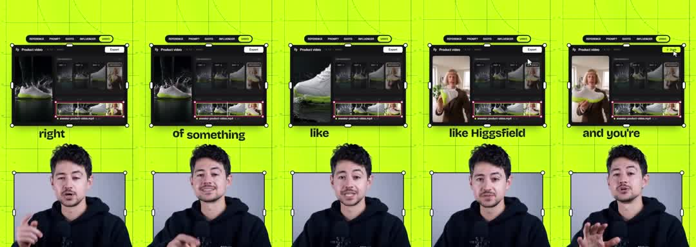

# v04_s13 · window_zoom · 23.0–25.2s (calidad 3)

- **Guion:** right inside of something like HiggsField, and you're done.
- **Qué se ve:** [obs] En el editor la vista previa cambia (zapatilla grande, luego el influencer); una franja de clips en la timeline se rodea en magenta; cursor pulsa 'Export'. 'DONE' en caja magenta.
- **Diseño:** [obs] Resaltado magenta en la timeline; botón Export blanco.
- **Efectos:** [obs] Ninguno.
- **Animación:** [obs] Previa cambia 23.75 y 24.5; cursor a 'Export' 24.8–25.0; 'DONE' pop 25.0.
- **Por qué aquí:** [inf] Final del proceso con acción concreta (exportar).
