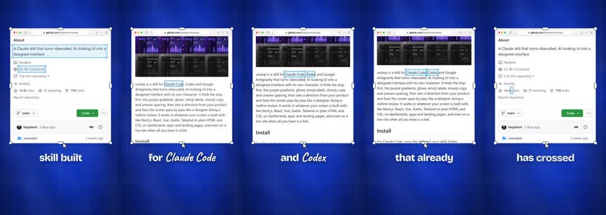

# v05_s04 · window_zoom · 8.3–10.3s (calidad 3)

- **Guion:** built for Claude code and codex that already has
- **Qué se ve:** [obs] La ventana baja al README (capturas moradas arriba y texto); se resaltan 'Claude Code' y 'Codex' en el párrafo.
- **Diseño:** [obs] 'Claude Code', 'Codex' serif itálica en caption.
- **Efectos:** [obs] Ninguno.
- **Animación:** [obs] Cambio/scroll 8.43; resaltado 'Claude Code' ~8.75, 'Codex' ~9.4.
- **Por qué aquí:** [inf] Literal: compatibilidad nombrada → marcada.
