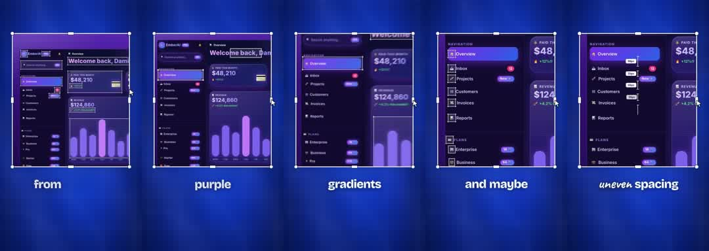

# v05_s08 · window_zoom · 16.6–19.8s (calidad 4)

- **Guion:** from glowing purple gradients to emojis and maybe uneven spacing.
- **Qué se ve:** [obs] Zoom dentro del dashboard a la barra lateral (Overview, Inbox, Projects, Customers…) y a las tarjetas con degradado; se marcan los iconos emoji y las separaciones desiguales con pequeños marcadores.
- **Diseño:** [obs] 'emojis', 'uneven' serif itálica en caption.
- **Efectos:** [obs] Ninguno.
- **Animación:** [obs] Punch-in progresivo 16.9–18.3 (≈1.0→1.8) hacia la izquierda-arriba; marcadores en 'emojis' (18.3) y 'uneven' (19.2).
- **Por qué aquí:** [inf] Detalle concreto de cada 'síntoma' nombrado.
