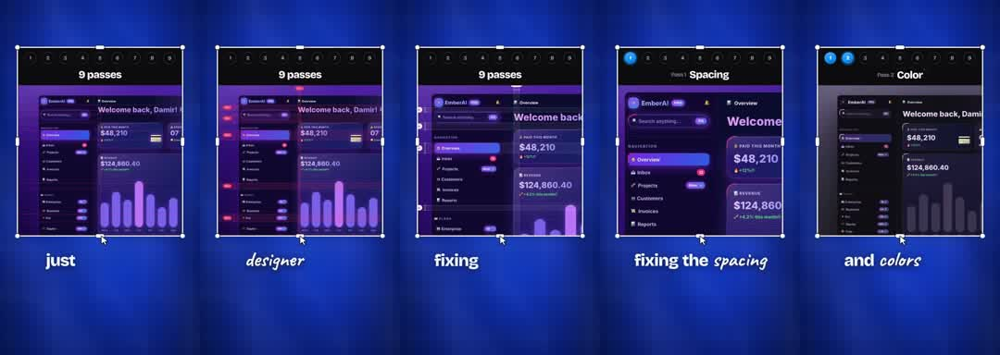

# v05_s11 · window_zoom · 26.1–29.0s (calidad 5)

- **Guion:** just like a real designer would, fixing the spacing and colors first.
- **Qué se ve:** [obs] El indicador de pasadas avanza: círculo 1 'Spacing' (el dashboard se reordena), luego 2 'Color' (el dashboard pasa de morado a negro sobrio).
- **Diseño:** [obs] Círculos activos en azul; título de pasada blanco ('Spacing', 'Color'); 'designer', 'spacing', 'colors' serif itálica.
- **Efectos:** [obs] Ninguno.
- **Animación:** [obs] Paso 1 activo ~27.8 ('spacing'), paso 2 ~28.75 ('colors'); el dashboard cambia de estilo en cada paso (corte interno).
- **Por qué aquí:** [inf] Lista de pasos dicha = indicador que avanza + transformación visible.
