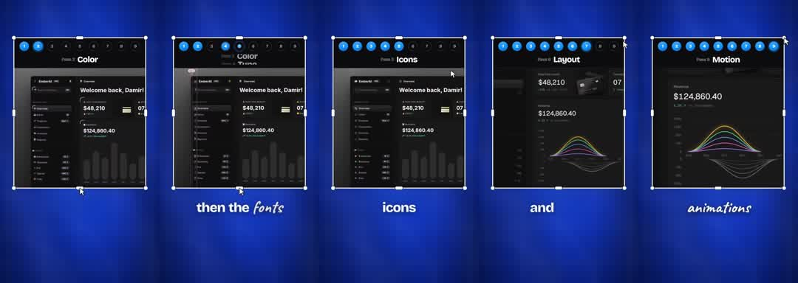

# v05_s12 · window_zoom · 29.0–31.5s (calidad 5)

- **Guion:** Then the fonts, icons, layout, and even animations.
- **Qué se ve:** [obs] Pasadas 'Type', 'Icons', 'Layout', 'Motion' una tras otra; el dashboard acaba negro y minimal con un gráfico de curvas de colores animadas.
- **Diseño:** [obs] 'fonts', 'animations' serif itálica.
- **Efectos:** [obs] Ninguno.
- **Animación:** [obs] Type ~29.75, Icons ~30.0, Layout ~30.5, Motion ~31.25; cada una con corte interno del dashboard (~0.5 s por paso).
- **Por qué aquí:** [inf] Aceleración: enumeración rápida = cambios rápidos.
