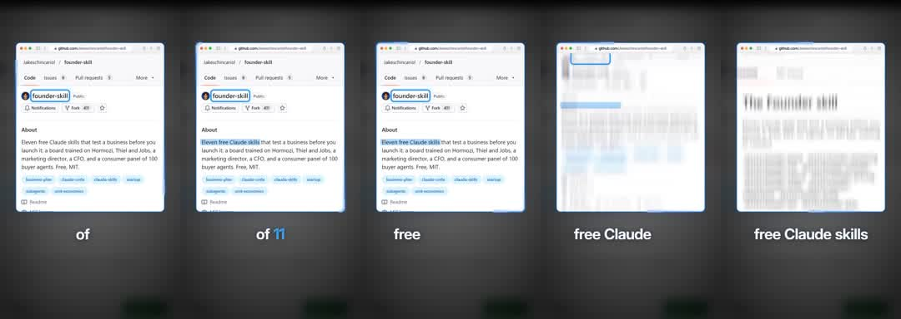

# v06_s05 · window_zoom · 7.7–9.0s (calidad 4)

- **Guion:** 11 free Claude skills
- **Qué se ve:** Misma página: resaltado azul sobre 'Eleven free Claude skills' en el About; luego desenfoque de transición hacia el README. (observado 7.75–8.75)
- **Diseño:** '11' del caption en azul; resaltado tipo selección de texto azul claro sobre la frase. (observado)
- **Efectos:** Blur gaussiano fuerte de la ventana en 8.75 como transición interna. (observado)
- **Animación:** Resaltado aparece de golpe en ~7.6 (sincronizado con '11'); a 8.75 la ventana se desenfoca y se cambia el contenido (blur-out/in ~0.25 s).
- **Por qué aquí:** Énfasis de dato: el número dicho se subraya en la fuente.
