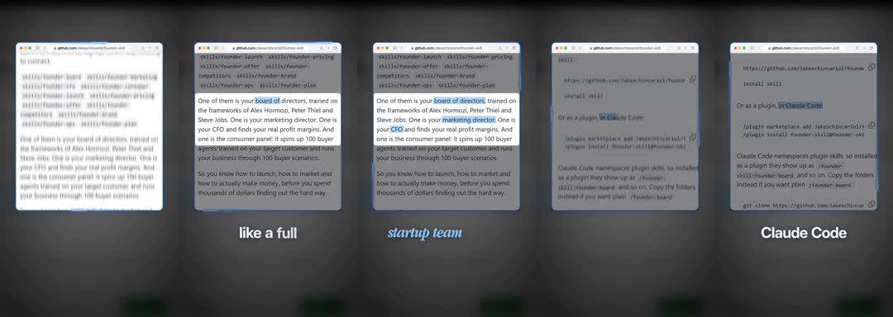

# v06_s06 · window_zoom · 9.0–11.8s (calidad 4)

- **Guion:** that work like a full startup team inside your Claude code.
- **Qué se ve:** README del repo: lista de skills y párrafo 'One of them is your board of directors…' con resaltados azules sucesivos (board of directors → marketing director → CFO → consumer panel); a 10.75 blur y salto a la sección de instalación con resaltado 'Claude Code'. (observado 9.0–11.5)
- **Diseño:** 'startup team' en serif itálica azul en el caption. Resaltados azul claro tipo selección. (observado 10.0)
- **Efectos:** Blur entre secciones; la ventana se oscurece/agrisa un poco al cambiar (observado 10.75).
- **Animación:** Un resaltado nuevo cada ~0.5 s siguiendo lo que enumera; cambio de sección con blur ~0.25 s.
- **Por qué aquí:** Describe el 'equipo' → muestra cada rol subrayado en el propio README.
