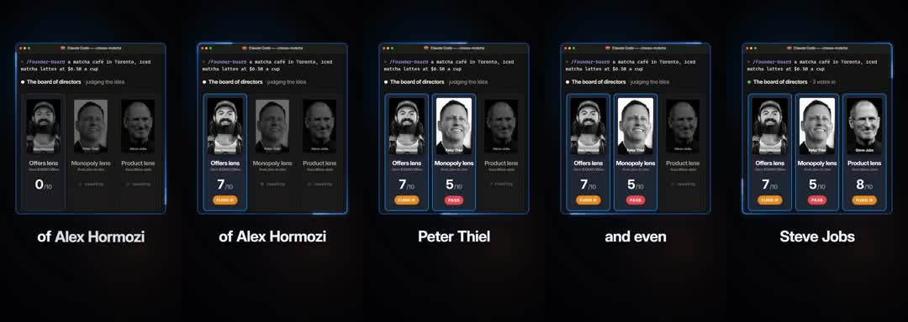

# v06_s09 · window_zoom · 15.7–18.3s (calidad 5)

- **Guion:** Alex Ramosy, Peter Thiel, and even Steve Jobs.
- **Qué se ve:** Cada retrato se ilumina y su tarjeta obtiene nota al decir el nombre: Hormozi 7/10 (15.9), Thiel 5/10 (16.75), Jobs 8/10 (17.75), con etiquetas naranja/roja. (observado)
- **Diseño:** Tarjeta activa con borde azul y foto a color/blanco más brillante; nota grande sans blanca; caption 'of Alex Hormozi' / 'Peter Thiel' / 'Steve Jobs' blanco.
- **Efectos:** Las tarjetas inactivas quedan atenuadas (~50 %).
- **Animación:** Highlight por nombre: tarjeta pasa de atenuada a activa en ~2 fr; contador numérico rueda (0→3→7). Sincronía palabra→tarjeta ±0.2 s.
- **Por qué aquí:** Literal: cada nombre dicho enciende su cara; mantiene el ojo moviéndose de izquierda a derecha.
