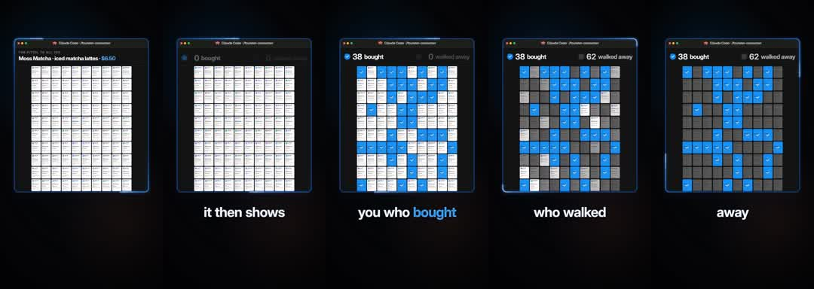

# v06_s14 · window_zoom · 28.2–30.4s (calidad 5)

- **Guion:** It then shows you who bought, who walked away,
- **Qué se ve:** La rejilla se tiñe: celdas azules = compraron (contador '38 bought'), grises = se fueron ('62 walked away'). (observado 28.75–30.0)
- **Diseño:** Contadores arriba a izquierda (azul) y derecha (gris). 'bought' en azul sans en el caption.
- **Efectos:** —
- **Animación:** Celdas cambian de color en oleada (~1 s) y contadores ruedan.
- **Por qué aquí:** Resultado = dato visual binario.
