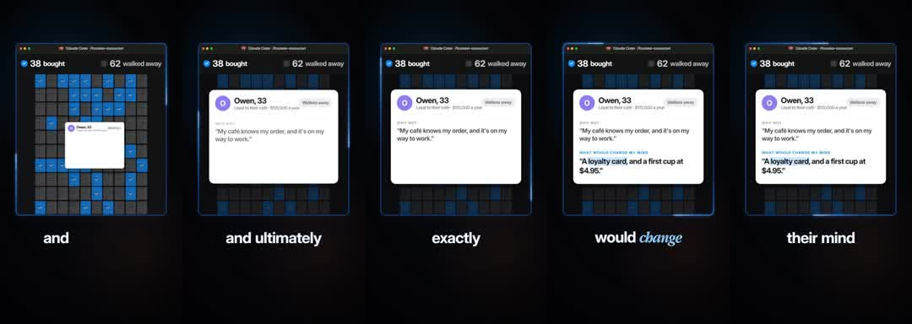

# v06_s15 · window_zoom · 30.4–33.1s (calidad 5)

- **Guion:** and ultimately what exactly would change their mind.
- **Qué se ve:** Sobre la rejilla atenuada aparece una tarjeta 'Owen, 33 · Walked away' con cita y 'WHAT WOULD CHANGE MY MIND: "A loyalty card, and a first cup at $4.95."' que se resalta. (observado 30.5–32.5)
- **Diseño:** Tarjeta blanca centrada ~60 % ancho de la ventana; 'change' serif itálica azul en caption.
- **Efectos:** Rejilla de fondo oscurecida.
- **Animación:** Tarjeta pop desde pequeño (escala ~30→100 %, ~0.3 s, observado 30.5–30.75); texto aparece por líneas; resaltado azul en 32.0.
- **Por qué aquí:** Del dato a la persona: el 'por qué' se muestra en una cita concreta.
