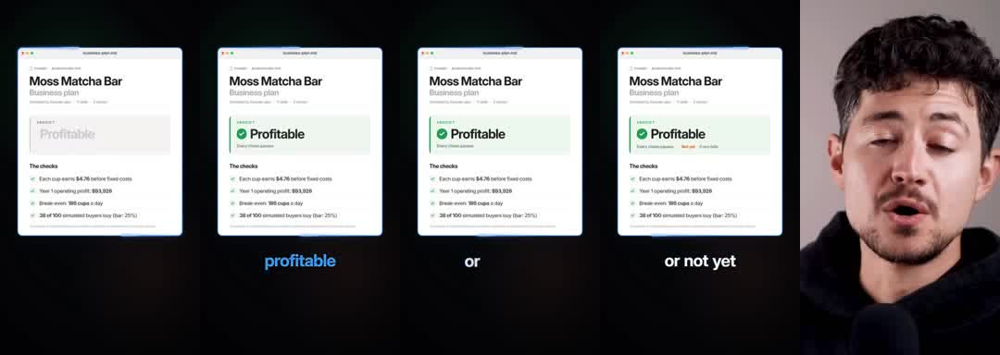

# v06_s19 · window_zoom · 40.6–41.7s (calidad 4)

- **Guion:** profitable, or not yet.
- **Qué se ve:** La caja de veredicto se vuelve verde con check y 'Profitable' grande. (observado 40.75)
- **Diseño:** Caja verde claro con borde verde a la izquierda; caption 'profitable' sans azul; 'or not yet' blanco.
- **Efectos:** —
- **Animación:** 'Profitable' aparece primero gris y luego verde (~0.25 s) — cambio de estado.
- **Por qué aquí:** Veredicto = momento de pago visual.
