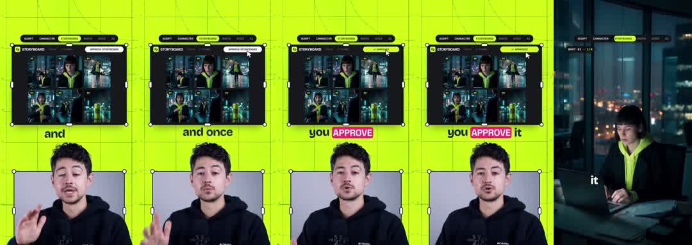

# v07_s11 · window_zoom · 25.1–26.0s (calidad 3)

- **Guion:** And once you approve it, it
- **Qué se ve:** Cursor pulsa el botón 'APPROVE STORYBOARD' (lima) en la esquina de la ventana. (observado 25.25–25.75)
- **Diseño:** 'APPROVE' caja magenta.
- **Efectos:** —
- **Animación:** Cursor entra y clic (botón cambia a ✓).
- **Por qué aquí:** Acción del usuario mostrada literalmente.
