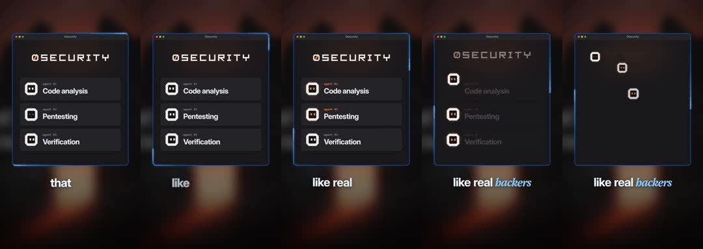

# v08_s08 · window_zoom · 17.7–19.1s (calidad 5)

- **Guion:** that act like real hackers.
- **Qué se ve:** El logo se disuelve y los 3 iconos de agente salen volando a la parte superior formando una barra de pestañas. (observado 18.5–19.25)
- **Diseño:** 'hackers' serif itálica azul claro (en pantalla se lee 'backers': posible errata o forma de la h, desconocido).
- **Efectos:** Disolución de texto.
- **Animación:** Iconos se desplazan en diagonal ~0.5 s hasta su pestaña (transición tipo morph/shared element).
- **Por qué aquí:** Transición: los agentes 'salen a trabajar'.
