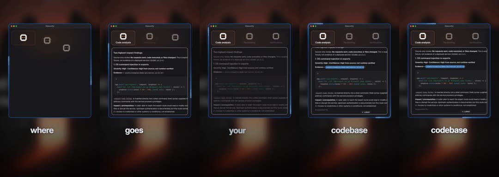

# v08_s09 · window_zoom · 19.1–20.6s (calidad 3)

- **Guion:** Where one goes through your whole code base,
- **Qué se ve:** Pestaña Code analysis activa: informe de hallazgos con línea resaltada en azul. (observado 19.25–20.5)
- **Diseño:** Pestaña activa con fondo claro; resaltado azul.
- **Efectos:** —
- **Animación:** Contenido entra con fade; resaltado ~0.3 s después.
- **Por qué aquí:** Agente 1 descrito → su pestaña.
