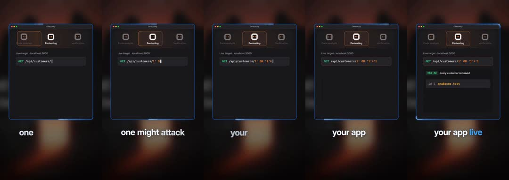

# v08_s10 · window_zoom · 20.6–21.9s (calidad 4)

- **Guion:** one might attack your app live,
- **Qué se ve:** Pestaña Pentesting: se teclea `GET /api/customers/' OR '1'='1` y responde '200 OK every customer returned'. (observado 20.75–21.75)
- **Diseño:** 'live' azul.
- **Efectos:** —
- **Animación:** Typing de la inyección; respuesta aparece de golpe.
- **Por qué aquí:** Ataque mostrado literal.
