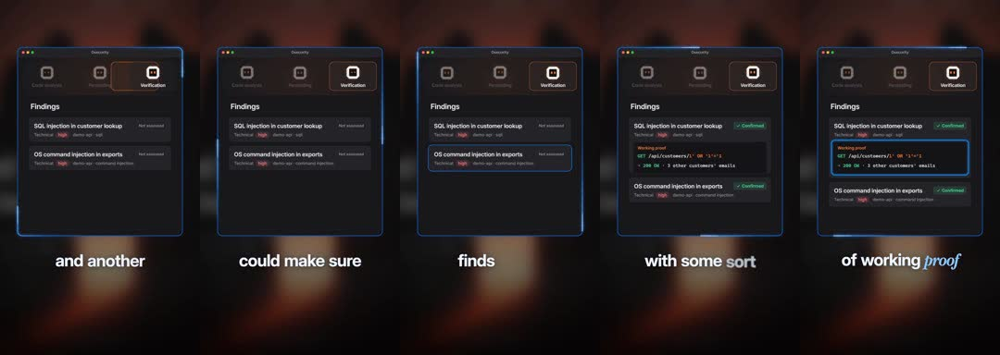

# v08_s11 · window_zoom · 21.9–25.8s (calidad 4)

- **Guion:** and another could make sure every flaw it finds is real with some sort of working proof.
- **Qué se ve:** Pestaña Verification: 'Findings' con 2 hallazgos; contornos azules (23.25), badges verdes 'Confirmed' (24.0) y bloque 'Working proof' desplegado (24.75). (observado)
- **Diseño:** 'real' azul; 'proof' serif itálica azul.
- **Efectos:** —
- **Animación:** Contornos por hallazgo al decir 'every flaw'; badges pop; despliegue de acordeón.
- **Por qué aquí:** Verificación = sello 'Confirmed' visible.
