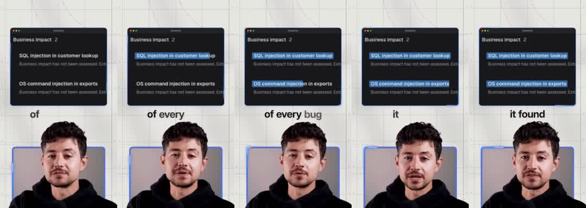

# v08_s13 · window_zoom · 27.5–28.4s (calidad 3)

- **Guion:** every bug it found,
- **Qué se ve:** Las dos líneas de bug se resaltan en azul una tras otra (27.75, 28.0). (observado)
- **Diseño:** Resaltado tipo selección azul.
- **Efectos:** —
- **Animación:** Resaltado por línea ~0.25 s.
- **Por qué aquí:** 'Every bug' → cada bug subrayado.
