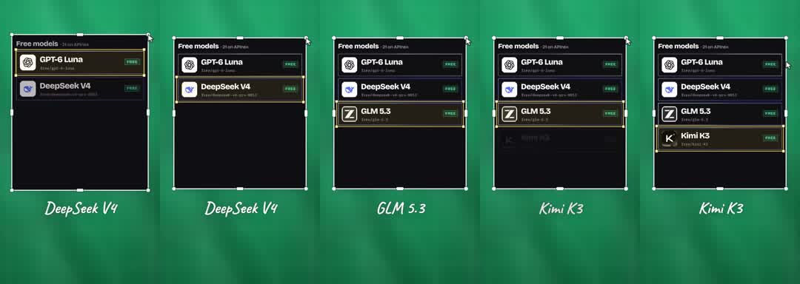

# v09_s06 · window_zoom · 12.6–16.0s (calidad 5)

- **Guion:** DeepSeq v4, GLM 5 .3, Kimmy K3,
- **Qué se ve:** Lista 'Free models' que se construye: cada modelo entra como fila nueva con marco amarillo al nombrarlo (DeepSeek V4 12.6, GLM 5.3 13.75, Kimi K3 15.2). (observado)
- **Diseño:** Caption solo el nombre del modelo en script itálica blanca grande (~4 % alto), y≈73 %.
- **Efectos:** —
- **Animación:** Fila nueva fade+slide desde abajo (~0.2 s) y el marco amarillo salta a ella.
- **Por qué aquí:** Enumeración 1:1 palabra→fila.
