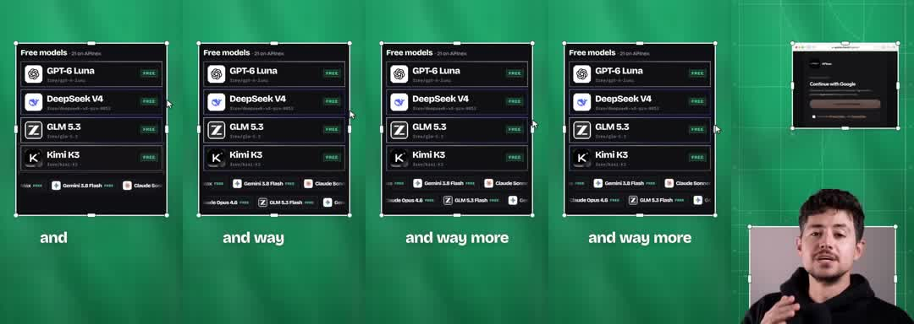

# v09_s07 · window_zoom · 16.0–16.9s (calidad 3)

- **Guion:** and way more.
- **Qué se ve:** Aparece una fila de chips de más modelos (Gemini 2.5 Flash, Claude Sonnet…) bajo la lista. (observado 16.0–16.5)
- **Diseño:** Chips pequeños; caption blanco.
- **Efectos:** —
- **Animación:** Chips deslizan horizontalmente (marquee) (inferido de 16.0–16.5).
- **Por qué aquí:** 'Y muchos más' = desbordamiento.
