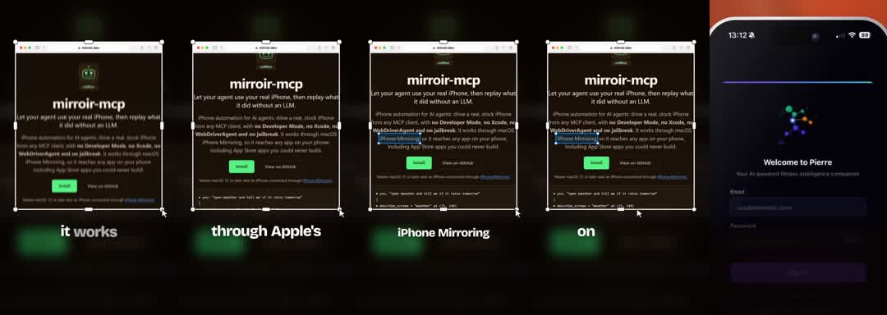

# v10_s04 · window_zoom · 6.2–8.5s (calidad 3)

- **Guion:** and it works through Apple's iPhone mirroring on your Mac,
- **Qué se ve:** La web se reencuadra (sube) y se resalta 'iPhone Mirroring' con caja azul de selección (7.25); cursor baja a la línea 'Needs macOS…' (8.0). (observado)
- **Diseño:** Resaltado azul con asas pequeñas.
- **Efectos:** —
- **Animación:** Ligero desplazamiento/zoom de la web (6.25) y resaltado de golpe.
- **Por qué aquí:** Requisito técnico señalado en la fuente.
