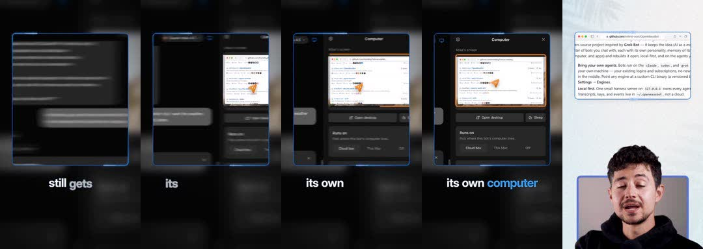

# v11_s03 · window_zoom · 4.3–5.3s (calidad 3)

- **Guion:** gets its own computer,
- **Qué se ve:** [obs 4.25–5.0] Transición borrosa dentro de la ventana: se pasa a la vista 'Computer' (escritorio virtual con captura enmarcada en naranja y botones 'Open desktop'/'Sleep').
- **Diseño:** Misma ventana sobre negro; subtítulo 'its own computer' con 'computer' en azul #2F9AF7.
- **Efectos:** [obs 4.25] Fotograma intermedio muy desenfocado (blur de transición) sobre fondo negro.
- **Animación:** [obs 4.25–4.75] Blur-out/blur-in con deslizamiento lateral del contenido (~0.4 s), luego la ventana se asienta; leve zoom-in.
- **Por qué aquí:** [inf] Literal: 'su propio ordenador' → aparece la pantalla del ordenador del agente.
