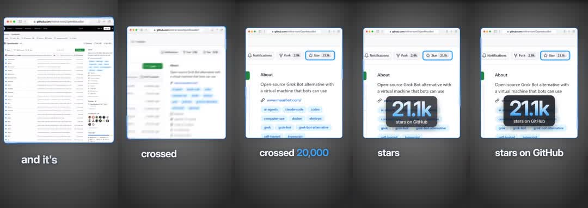

# v11_s06 · window_zoom · 9.7–11.9s (calidad 5)

- **Guion:** it's already crossed 20 ,000 stars on GitHub.
- **Qué se ve:** [obs 9.75–11.5] Lienzo gris con degradado: página de GitHub de OpenMausBot que hace zoom al bloque 'About' y al botón 'Star 21.1k' (recuadrado en azul); en 11.25 aparece una tarjeta translúcida '21.1k stars on GitHub' sobre la ventana.
- **Diseño:** [medido 10.8] Ventana x 8.6–91.4 %, y 13.3–66.4 %; borde azul #4795DE; tarjeta 21.1k vidrio esmerilado oscuro con cifra sans bold blanca grande (~6 % alto). Subtítulo blanco y≈73 %, '20,000' azul.
- **Efectos:** [obs] Lienzo gris radial #2D2D2D–#4F4F4F; tarjeta con glassmorphism (blur detrás).
- **Animación:** [obs 9.75–10.5] zoom-in rápido de captura completa a detalle (≈0.5 s, ease-out); recuadro azul en 'Star'; tarjeta pop en 11.25 (0.1 s).
- **Por qué aquí:** [inf] Prueba social cuantificada: el dato se ve en la fuente y se repite en grande.
