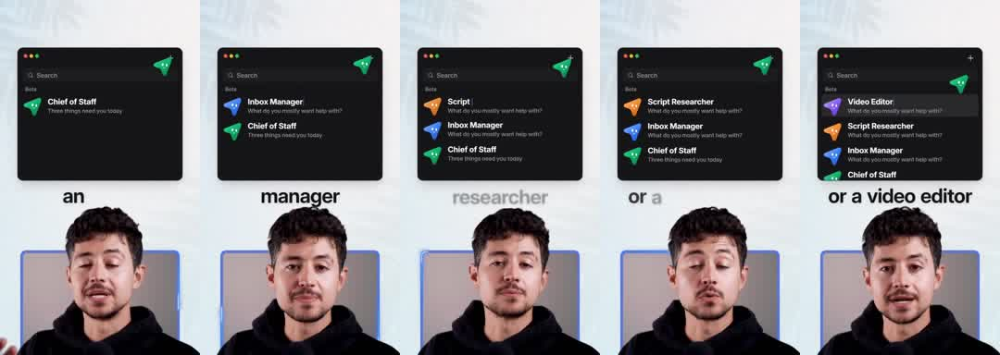

# v11_s08 · window_zoom · 14.5–17.4s (calidad 5)

- **Guion:** an inbox manager, a script researcher, or a video editor.
- **Qué se ve:** [obs 14.75–17.25] La lista de bots crece: 'Inbox Manager' (14.75), 'Script Researcher' (15.75), 'Video Editor' (16.75) se insertan arriba y empujan a los demás hacia abajo, cada uno con su icono de color.
- **Diseño:** Mismo layout que s07; nombres de bot sans semibold blanca dentro de la app.
- **Efectos:** [obs] fila nueva resaltada (fondo gris #2A2A2C) mientras se escribe su nombre.
- **Animación:** [obs] cada fila entra deslizándose desde arriba y el nombre se escribe letra a letra ('Inbox Mana…', 'Scri…', 'Video Edi…') sincronizado con la palabra (offset ≈+0.1 s).
- **Por qué aquí:** [inf] Enumeración literal: cada ejemplo dicho se materializa en la UI.
