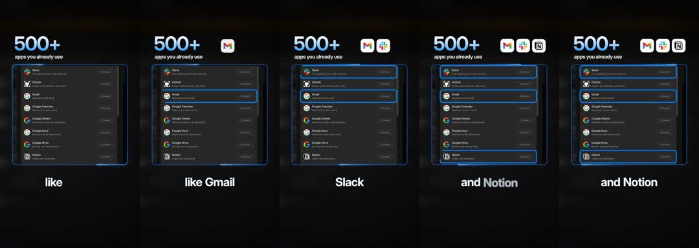

# v11_s14 · window_zoom · 32.4–34.0s (calidad 5)

- **Guion:** like Gmail, Slack, and Notion,
- **Qué se ve:** [obs 32.5–33.75] Al nombrar cada app, su fila se recuadra en azul en la lista y su logo (Gmail, Slack, Notion) aparece en una ficha blanca junto a '500+'.
- **Diseño:** Logos ~5 % ancho en fila, a la derecha de '500+'; recuadros azules redondeados en filas.
- **Efectos:** —
- **Animación:** [obs] pop del logo + recuadro por palabra (32.75 Gmail, 33.0 Slack, 33.5 Notion), offset ≈+0.1 s.
- **Por qué aquí:** [inf] Logos reconocibles = credibilidad instantánea; sincronía literal.
