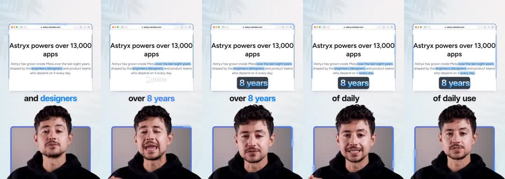

# v12_s07 · window_zoom · 13.4–15.5s (calidad 4)

- **Guion:** over eight years of daily use.
- **Qué se ve:** [obs 13.75–15.25] Se resalta 'over the last eight years' y aparece un chip oscuro '8 years' sobre la ventana; luego 'every day' resaltado.
- **Diseño:** Chip gris oscuro redondeado con '8 years' sans bold blanca ~3 % alto, centrado en la parte baja de la ventana.
- **Efectos:** [obs] chip con desenfoque de fondo (glass).
- **Animación:** [obs 14.0–14.5] el '8' rueda como contador (dígito con blur vertical) y se asienta; pop del chip.
- **Por qué aquí:** [inf] Dato temporal convertido en etiqueta visible.
