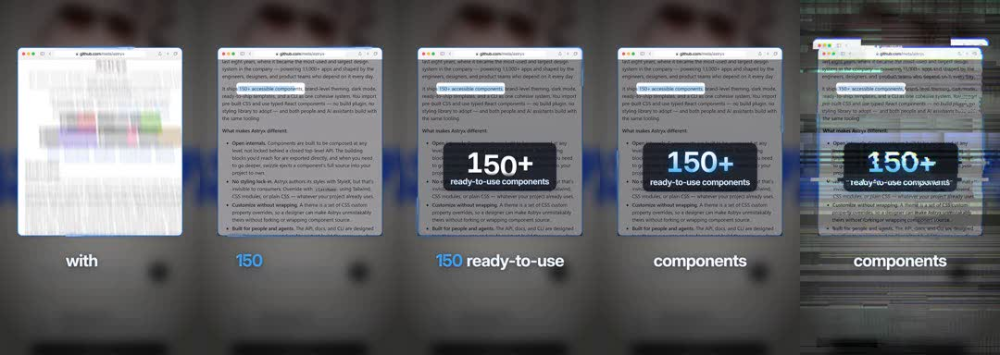

# v12_s09 · window_zoom · 17.1–19.3s (calidad 5)

- **Guion:** over a hundred and fifty Reddit use components and
- **Qué se ve:** [obs 17.0–19.0] Scroll borroso hacia el README; se resalta '150+ accessible components'; aparece tarjeta glass '150+ ready-to-use components' con contador.
- **Diseño:** Tarjeta oscura translúcida redondeada ~45 % ancho centrada en y≈38 %; '150+' sans bold blanca ~5 % alto; '150' azul en subtítulo.
- **Efectos:** [obs 17.0–17.25] desenfoque de movimiento vertical durante el scroll.
- **Animación:** [obs 18.0–18.25] contador '02…15…150+' rueda (≈0.3 s) y se asienta.
- **Por qué aquí:** [inf] Cifra → tarjeta con contador.
