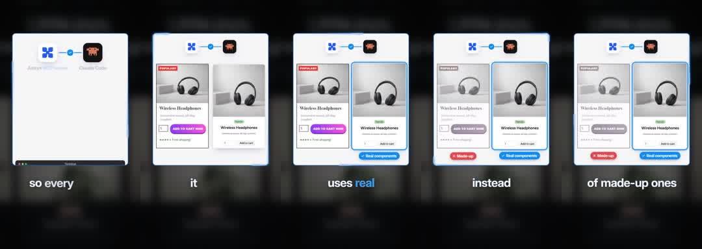

# v12_s13 · window_zoom · 27.3–30.8s (calidad 4)

- **Guion:** so every design it builds uses real components instead of made-up ones.
- **Qué se ve:** [obs 27.5–30.5] El terminal desaparece; aparecen dos fichas de producto (auriculares): la derecha se recuadra en azul con etiqueta 'Real components'; la izquierda recibe etiqueta roja 'Made-up'.
- **Diseño:** Etiquetas píldora: azul #1F6FF0 con check y roja #E03A3A con x, sans bold blanca pequeña.
- **Efectos:** —
- **Animación:** [obs] fichas pop 27.75; recuadro azul 28.75; etiqueta azul 29.0; etiqueta roja 29.75 (al decir 'instead').
- **Por qué aquí:** [inf] Comparación real vs inventado con código de color.
