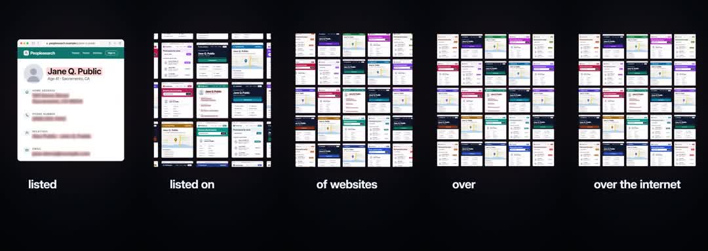

# v13_s04 · window_zoom · 8.0–10.3s (calidad 5)

- **Guion:** listed on dozens of websites all over the internet,
- **Qué se ve:** [obs 8.25–10.0] La ventana del perfil se aleja y se convierte en una pieza de un mosaico de ~25 capturas de webs de búsqueda de personas que llena la pantalla.
- **Diseño:** Mosaico 5×6 de tarjetas con cabeceras de colores (rojo, verde, azul, morado) sobre negro; subtítulo blanco y≈73 %.
- **Efectos:** [obs] negro; tarjetas con sombra.
- **Animación:** [obs 8.25–8.75] zoom-out rápido (≈0.4 s) del perfil al mosaico; las tarjetas se densifican hasta 9.0.
- **Por qué aquí:** [inf] 'dozens of websites' → escala visual de la exposición.
