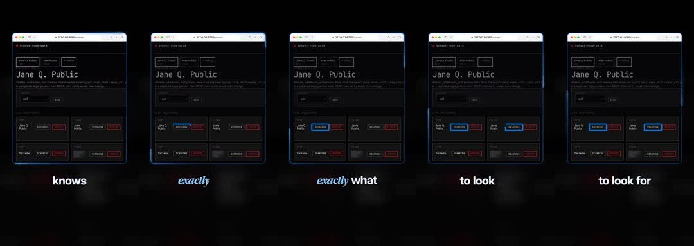

# v13_s08 · window_zoom · 17.7–19.0s (calidad 3)

- **Guion:** knows exactly what to look for.
- **Qué se ve:** [obs 17.5–18.75] Glitch y aparece un panel oscuro 'Jane Q. Public' con tarjetas de perfiles coincidentes; se recuadran en azul los que coinciden.
- **Diseño:** 'exactly' serif itálica azul; recuadros azules en botones de coincidencia.
- **Efectos:** [obs 17.5] glitch de líneas horizontales.
- **Animación:** [obs] recuadros azules aparecen 18.0–18.5.
- **Por qué aquí:** [inf] Precisión → selección marcada.
