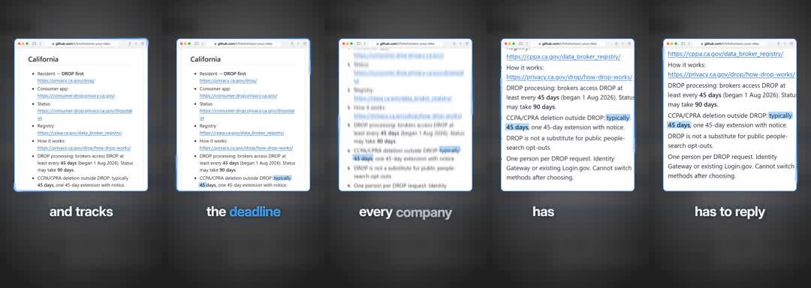

# v13_s12 · window_zoom · 29.8–31.9s (calidad 3)

- **Guion:** then tracks the deadline every company has to reply.
- **Qué se ve:** [obs 29.75–31.75] Glitch → lienzo gris: documento 'California' (DROP, CCPA/CPRA) que hace scroll y resalta '45 days'.
- **Diseño:** 'deadline' azul en subtítulo.
- **Efectos:** [obs 29.5] glitch; fondo gris radial.
- **Animación:** [obs] scroll con motion blur 30.75; resaltado '45 days' 31.25.
- **Por qué aquí:** [inf] Dato legal concreto (plazo).
