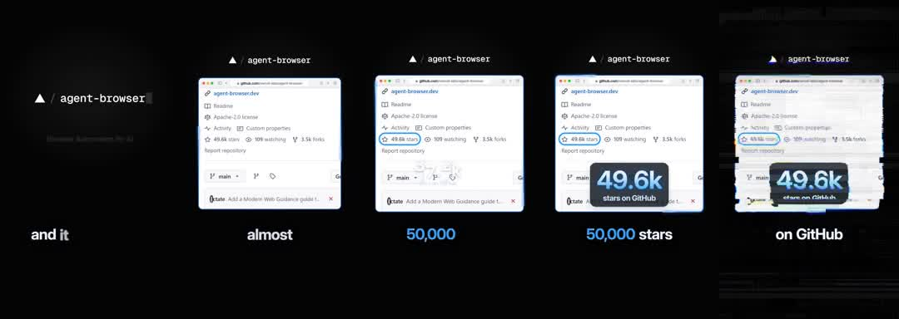

# v14_s07 · window_zoom · 14.6–17.1s (calidad 4)

- **Guion:** and it already has almost 50 ,000 stars on GitHub.
- **Qué se ve:** [obs 14.75–16.75] El título 'agent-browser' sube arriba y debajo entra la tarjeta del repo de GitHub; '49.6k stars' se recuadra en azul; aparece una tarjeta glass '49.6k stars on GitHub' con contador.
- **Diseño:** Tarjeta repo blanca y≈18–30 %; '50,000' azul en subtítulo.
- **Efectos:** [obs] tarjeta glass oscura translúcida.
- **Animación:** [obs] placeholder gris que sube (15.0–15.25) → repo; recuadro 15.5; contador 16.0–16.25.
- **Por qué aquí:** [inf] Prueba social.
