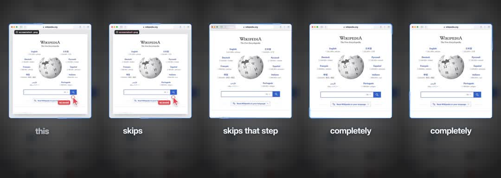

# v14_s09 · window_zoom · 20.6–22.5s (calidad 2)

- **Guion:** this one skips that step completely by
- **Qué se ve:** [obs 20.75–22.25] Desaparece la etiqueta 'screenshot.png' y el cursor; la página queda limpia.
- **Diseño:** Misma ventana.
- **Efectos:** —
- **Animación:** [obs 21.5] fade-out de los elementos de 'screenshot' (≈0.2 s).
- **Por qué aquí:** [inf] 'skips that step' literal: lo quita.
