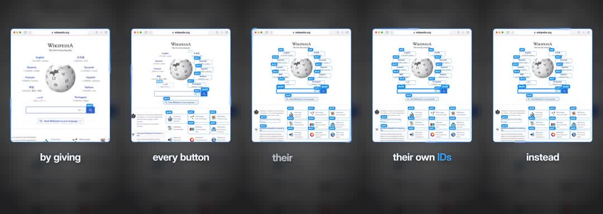

# v14_s10 · window_zoom · 22.5–25.5s (calidad 5)

- **Guion:** giving every button and field their own IDs instead.
- **Qué se ve:** [obs 22.75–25.25] Sobre cada botón y campo de Wikipedia aparecen chips azules con IDs (@e1, @e2…) y recuadros azules, hasta cubrir la página.
- **Diseño:** Chips azul #1D82E0 con texto blanco mono diminuto; 'IDs' azul en subtítulo.
- **Efectos:** —
- **Animación:** [obs] chips aparecen en cascada (≈10 por 0.25 s) 22.75–24.0.
- **Por qué aquí:** [inf] Concepto técnico abstracto (IDs) hecho visible.
