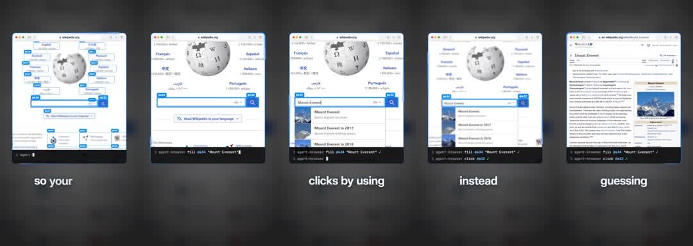

# v14_s11 · window_zoom · 25.5–28.3s (calidad 4)

- **Guion:** So your agent clicks by using that ID instead of guessing,
- **Qué se ve:** [obs 25.5–28.0] Zoom al buscador; abajo terminal 'agent-browser fill @e34 "Mount Everest"' y 'click @e32'; aparecen sugerencias y se abre la página del Everest.
- **Diseño:** Terminal negra en la base de la ventana.
- **Efectos:** —
- **Animación:** [obs] punch-in 25.5–25.75 (≈1.0→1.3); typing 26.0–26.75; cambio de página 27.75.
- **Por qué aquí:** [inf] Demuestra el mecanismo con el ID concreto.
