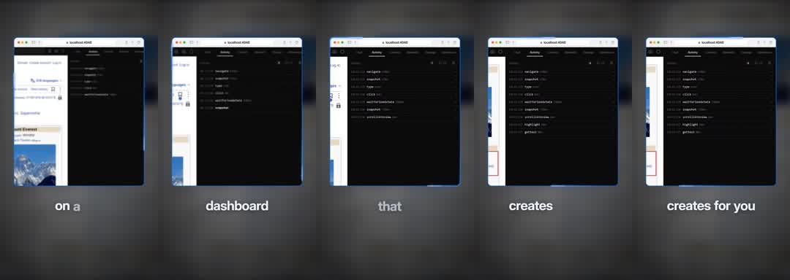

# v14_s16 · window_zoom · 39.3–41.4s (calidad 4)

- **Guion:** live dashboard that it creates for you.
- **Qué se ve:** [obs 39.25–41.25] El contenido desliza a la izquierda y aparece el panel 'Activity' con log (navigate, snapshot, type, click, waitForLoadState, scrollIntoView, highlight, gettext) que va creciendo.
- **Diseño:** 'live' azul.
- **Efectos:** —
- **Animación:** [obs] slide horizontal 39.25 (≈0.25 s); una línea de log nueva cada ~0.25 s.
- **Por qué aquí:** [inf] 'dashboard' literal.
