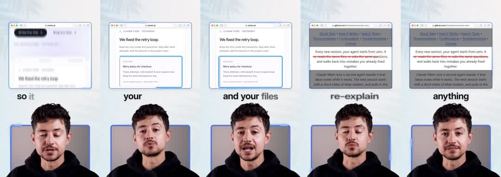

# v15_s05 · window_zoom · 8.0–11.8s (calidad 4)

- **Guion:** so it remembers your projects and your files without you ever having to re -explain anything.
- **Qué se ve:** [obs 8.0–11.5] Transición borrosa a una nota de memoria 'We fixed the retry loop' con recuadro azul en 'Retry policy for checkout'; luego otra transición borrosa a un README donde 're-reads the same files, re-asks the same questions' aparece tachado en rojo y el entorno se oscurece.
- **Diseño:** Tachado rojo #E03A3A; atenuado gris del resto.
- **Efectos:** [obs 8.0, 10.25] blur fuerte de transición dentro de la ventana.
- **Animación:** [obs] blur-in 8.0–8.25; recuadro 9.0; blur 10.25; tachado 10.75.
- **Por qué aquí:** [inf] Muestra lo que se recuerda y tacha el dolor ('re-explain').
