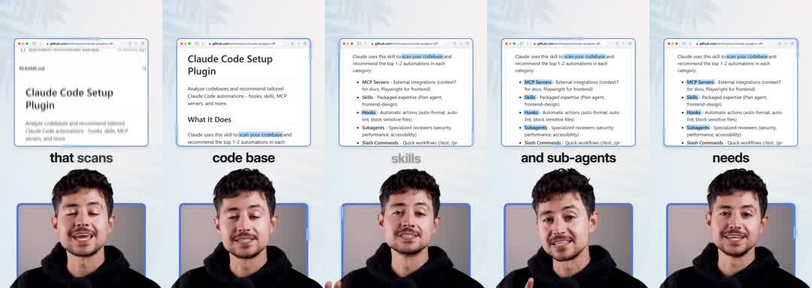

# v15_s12 · window_zoom · 25.1–30.7s (calidad 4)

- **Guion:** scans your entire code base and sets up the best hooks, skills, MCPs, and sub -agents that your project needs.
- **Qué se ve:** [obs 25.0–30.5] Scroll borroso al README 'Claude Code Setup Plugin'; se resalta 'scan your codebase'; luego en la lista se resaltan sucesivamente Hooks, Skills, MCP Servers, Subagents al nombrarlos.
- **Diseño:** Resaltados azul claro tipo marcador.
- **Efectos:** [obs 25.0, 26.75] scroll con motion blur.
- **Animación:** [obs] resaltados 27.5 hooks, 28.0 skills, 28.75 MCP, 29.25 subagents.
- **Por qué aquí:** [inf] Enumeración literal sincronizada.
