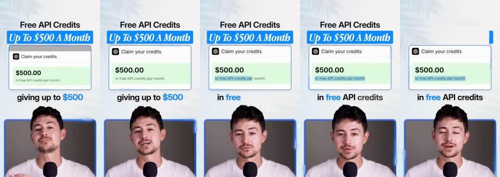

# v16_s02 · window_zoom · 1.8–3.3s (calidad 4)

- **Guion:** bucks in free API credits
- **Qué se ve:** Misma composición con título; la ventana hace zoom/recorte al modal 'Claim your credits · $500.00 · In free API credits per month' y luego se resalta 'In free API credits per month'. Caption 'in free API credits' con 'free' azul.
- **Diseño:** Igual que s01; tarjeta verde claro #D8F2D9 del modal con '$500.00' grande negro dentro de la ventana.
- **Efectos:** Highlight azul translúcido tipo selección de texto (#B9D7F5 aprox) sobre la línea.
- **Animación:** [observed 1.5→2.0] Zoom-in dentro de la ventana al modal (≈0.3 s, ease-out). [observed 2.5] resaltado aparece de izquierda a derecha. [observed 3.13→3.40] título sale: letras se borran/fade y caja azul se retrae hacia la derecha antes del corte.
- **Por qué aquí:** [inferred] Describir → mostrar: 'free API credits' = la línea literal en pantalla.
