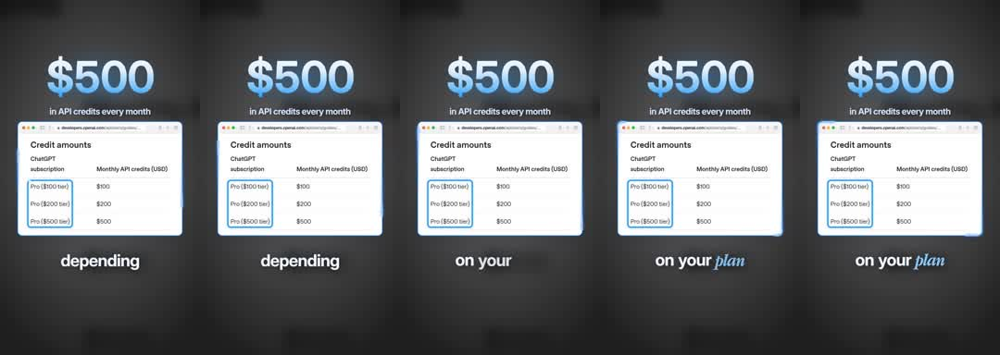

# v16_s07 · window_zoom · 11.5–12.2s (calidad 3)

- **Guion:** depending on your plan.
- **Qué se ve:** Recuadros azules dibujados alrededor de la columna de 'tier' de la tabla. Caption 'on your plan' con 'plan' serif itálica.
- **Diseño:** Contorno azul #2E7BE0 ~2 px con radio pequeño alrededor de cada celda tier.
- **Efectos:** —
- **Animación:** [observed 11.4] recuadros aparecen de golpe (1–2 fr).
- **Por qué aquí:** [inferred] Énfasis: 'depende del plan' = señalar la columna de planes.
