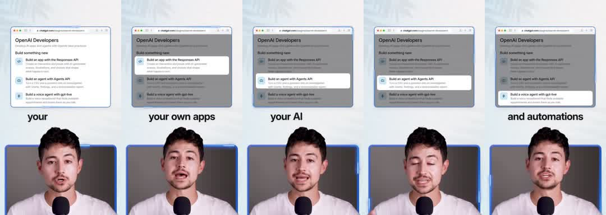

# v16_s09 · window_zoom · 13.3–15.5s (calidad 5)

- **Guion:** own apps, your AI agents, and automations,
- **Qué se ve:** Spotlight: la ventana se oscurece con velo gris y solo la tarjeta nombrada queda blanca (Responses API → Agents API → voice agent), una por palabra.
- **Diseño:** Velo gris ~50 % sobre la captura; tarjeta activa blanca con leve elevación.
- **Efectos:** Atenuado (dim) del resto de la UI.
- **Animación:** [observed 13.67, 14.33, ~15.0] el foco salta de tarjeta en 1–2 fr, sincronizado con 'apps', 'AI', 'automations'.
- **Por qué aquí:** [inferred] Literal: cada uso dicho = su tarjeta iluminada (lista visual).
