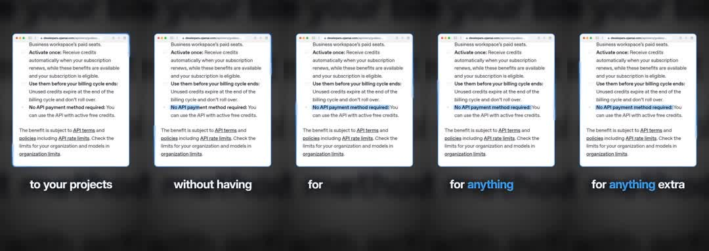

# v16_s12 · window_zoom · 18.1–19.5s (calidad 3)

- **Guion:** without having to pay for anything extra.
- **Qué se ve:** Doc de OpenAI (lista 'Activate once', 'Use them before…', 'No API payment method required'); se resalta en azul 'No API payment method required'. Caption 'without having' / 'for anything extra' con 'anything' azul.
- **Diseño:** Ventana x 10–90 % × y ≈30–55 %; caption y≈73 %.
- **Efectos:** Viñeta oscura.
- **Animación:** [observed 18.17] corte seco; [observed 18.4] highlight aparece.
- **Por qué aquí:** [inferred] Prueba documental de 'sin pagar extra'.
