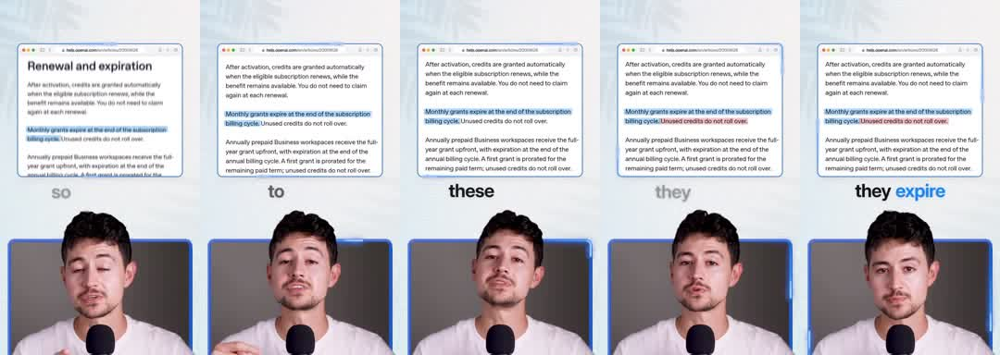

# v16_s14 · window_zoom · 21.2–23.0s (calidad 4)

- **Guion:** so you have to claim these before they expire.
- **Qué se ve:** La ventana hace scroll al párrafo resaltado; en 'expire' la frase 'Unused credits do not roll over' se pinta en ROJO.
- **Diseño:** Texto rojo ~#E03A3A sobre doc; caption 'they expire' con 'expire' azul.
- **Efectos:** —
- **Animación:** [observed ~21.0] scroll suave del doc (≈0.3 s). [observed 22.5] texto pasa a rojo.
- **Por qué aquí:** [inferred] Énfasis negativo: rojo = pérdida si no reclamas.
