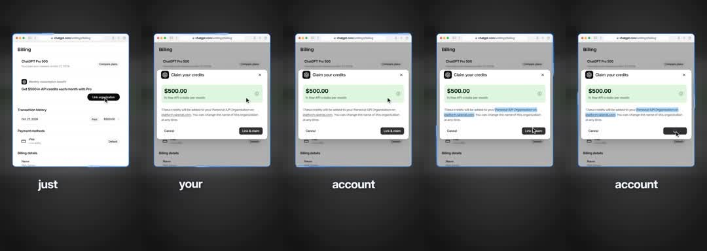

# v16_s16 · window_zoom · 24.5–27.1s (calidad 4)

- **Guion:** Just connect your ChatGBT account to your OpenAD developer account,
- **Qué se ve:** Demo de clics: cursor pulsa 'Link organization' → modal 'Claim your credits $500.00' → resaltado 'Personal API Organization on platform.openai.com' → cursor pulsa 'Link & claim'.
- **Diseño:** Ventana x 10–90 % × y 13.3–66.3 %; fondo de página atenuado bajo el modal. Caption 'your ChatGPT' / 'to your OpenAI' con marcas en serif itálica azul.
- **Efectos:** Dim de la página tras el modal.
- **Animación:** [observed 24.8] clic; [observed 24.87–25.0] modal fade+scale-in (~3 fr); [observed 26.0] highlight; [observed ~26.5] clic en botón.
- **Por qué aquí:** [inferred] Tutorial literal: cada verbo = un clic visible.
