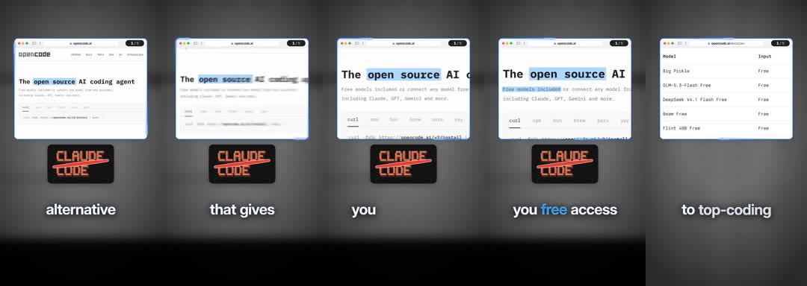

# v17_s06 · window_zoom · 7.8–9.3s (calidad 3)

- **Guion:** that gives you free access to
- **Qué se ve:** Zoom dentro de la ventana al titular 'The open source AI coding agent' y resaltado 'Free models included'.
- **Diseño:** Texto monoespaciado grande en la captura; 'free' azul en caption.
- **Efectos:** —
- **Animación:** [observed 8.0→8.5] punch-in ≈1.0→1.4 (≈0.3 s).
- **Por qué aquí:** [inferred] Literal 'free access'.
