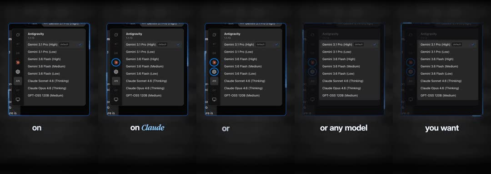

# v17_s20 · window_zoom · 34.3–36.3s (calidad 3)

- **Guion:** on Claude codecs or any model you want
- **Qué se ve:** Selector de modelos (Antigravity: Gemini 3.1 Pro, Claude Sonnet 4.6, Claude Opus 4.6, GPT-OSS 120B) con zoom/desplazamiento.
- **Diseño:** 'Claude', 'Codex' serif itálica azul.
- **Efectos:** —
- **Animación:** [observed 34.0–34.5] corte/zoom al desplegable.
- **Por qué aquí:** [inferred] 'any model' = lista de modelos.
