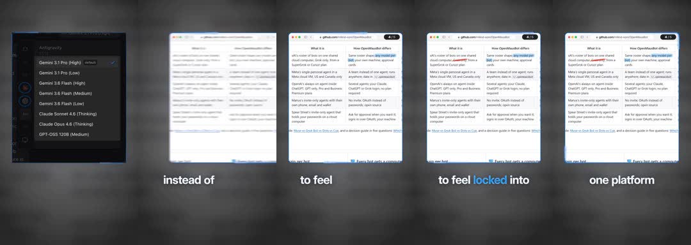

# v17_s21 · window_zoom · 36.3–38.2s (calidad 4)

- **Guion:** instead of having to feel locked into one platform.
- **Qué se ve:** Transición tipo whip horizontal a tabla comparativa 'What it is / How OpenMausBot differs'; resaltado y una palabra tachada en rojo; 'locked' azul.
- **Diseño:** Ventana y≈12–56 %.
- **Efectos:** Motion blur horizontal.
- **Animación:** [observed 36.4–36.6] slide horizontal con motion-blur: la ventana nueva empuja desde la derecha (≈5 fr).
- **Por qué aquí:** [inferred] Contraste: lock-in vs libertad.
