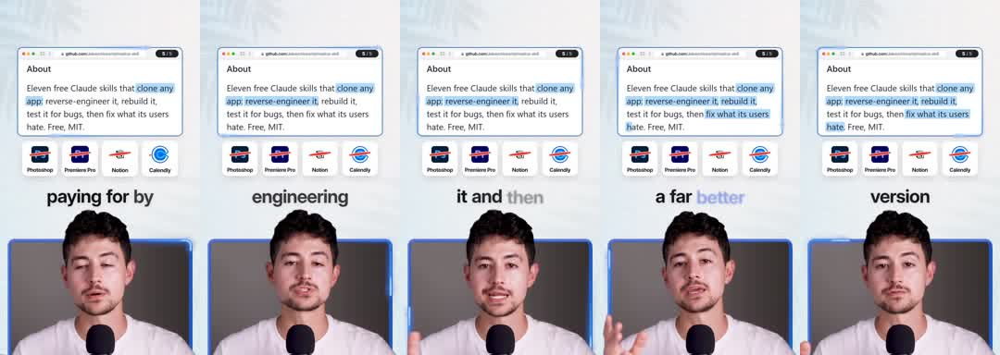

# v17_s24 · window_zoom · 41.9–44.5s (calidad 4)

- **Guion:** by reverse engineering it and then building a far better version.
- **Qué se ve:** Resaltados progresivos en el texto: 'reverse-engineer it' → 'rebuild it' → 'fix what its users hate'.
- **Diseño:** Resaltado azul claro #B9D7F5.
- **Efectos:** —
- **Animación:** [observed 42.0, 43.0, 43.5] cada resaltado se extiende con la palabra.
- **Por qué aquí:** [inferred] Lectura guiada: el resaltado sigue a la voz.
