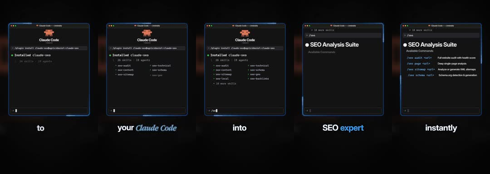

# v18_s03 · window_zoom · 4.3–6.8s (calidad 3)

- **Guion:** to turn your Claude code into an SEO expert instantly.
- **Qué se ve:** La terminal muestra 'Installed claude-seo · 26 skills · 19 agents' con lista de comandos; en 6.0 pasa a 'SEO Analysis Suite' con comandos /seo audit, /seo page, /seo sitemap…
- **Diseño:** 'Claude Code' serif itálica azul; 'expert' azul.
- **Efectos:** —
- **Animación:** [observed 4.5] el contenido sube (scroll) tras el install; [observed 6.0] corte interno a la suite.
- **Por qué aquí:** [inferred] Prueba de instalación instantánea.
