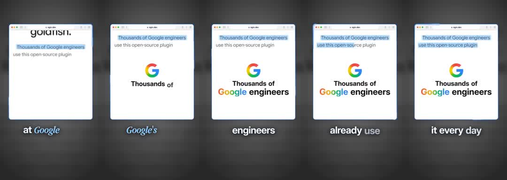

# v19_s05 · window_zoom · 6.2–8.6s (calidad 4)

- **Guion:** and Google's own engineers already use it every day.
- **Qué se ve:** Dentro de la ventana: logo G de Google y 'Thousands of Google engineers' grande (Google multicolor), con las dos líneas superiores resaltadas.
- **Diseño:** Texto sans bold negra; 'Google' en colores de marca.
- **Efectos:** —
- **Animación:** [observed 6.5–7.0] el texto 'Thousands of' → 'Thousands of Google engineers' se completa por palabra.
- **Por qué aquí:** [inferred] Dato de autoridad hecho gráfico.
