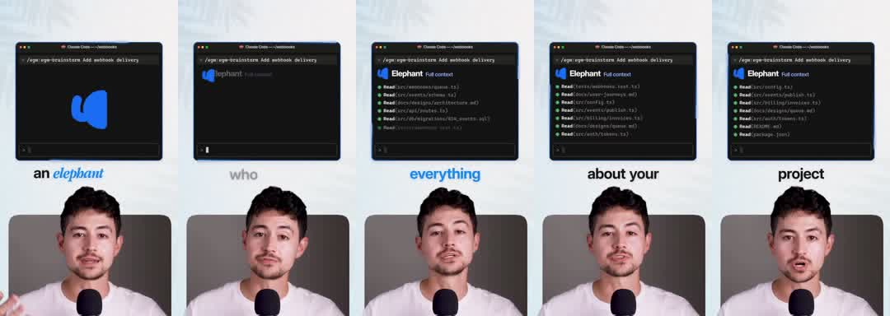

# v19_s09 · window_zoom · 13.4–15.8s (calidad 5)

- **Guion:** an elephant agent who knows everything about your project
- **Qué se ve:** El logo del elefante aparece grande en la terminal (13.33) y luego encoge y viaja a la esquina superior como cabecera 'Elephant · Full context'; después lista de 'Read(…)' de archivos del proyecto.
- **Diseño:** 'elephant' serif itálica azul; 'everything' azul.
- **Efectos:** —
- **Animación:** [observed 13.33 pop; 13.8–14.07] logo→etiqueta: escala 1→0.2 y traslación a la esquina (≈8 fr). [observed 14.5–15.5] líneas Read se acumulan.
- **Por qué aquí:** [inferred] El personaje 'elefante' entra en escena y se convierte en etiqueta del agente.
